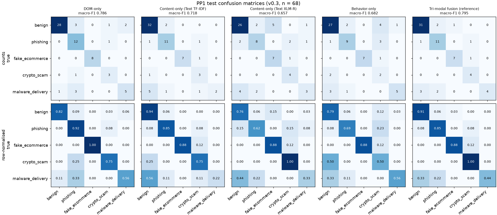
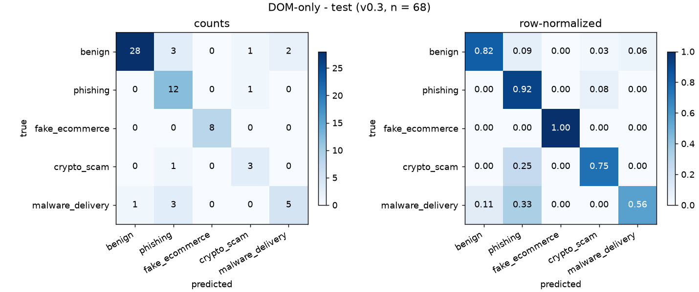
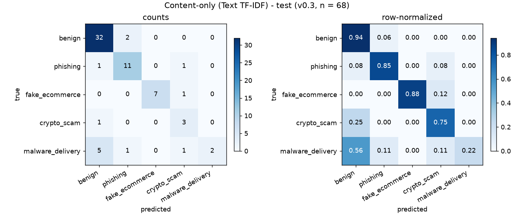
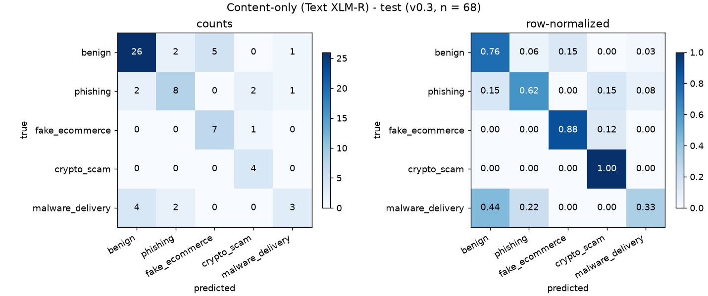
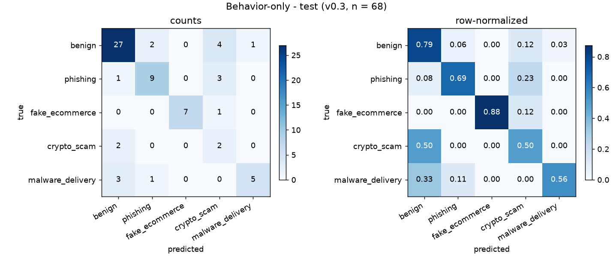
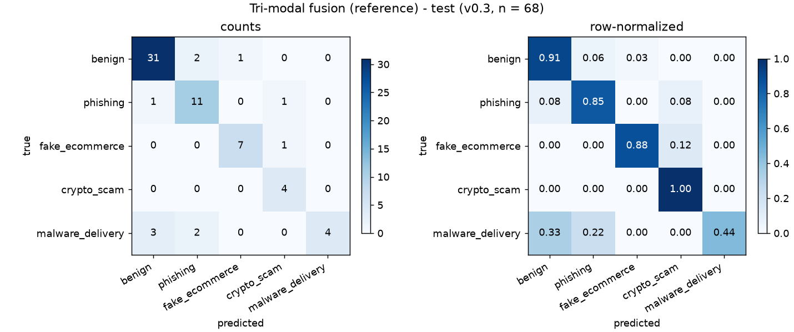

# PP1 evaluation - dataset v0.3

Part 10. Consolidated from saved predictions; no model was trained or re-fitted. Re-run: `python scripts/pp1_evaluation.py --version v0.3`.

## 1. Evaluation dataset (frozen)

| item | value |
|---|---|
| dataset version | v0.3 |
| manifest fingerprint | `7a620c3b7ea05f42747d1a418a0663befa62a7c6ade6335f4557b52fda77cc26` |
| manifest verification | 459 files re-hashed: 0 missing, 0 changed → OK |
| split fingerprint | `7d9ae69bbae3f5c699c022eb4ef74334ac49c4e95d68f30f9d480c9e55324f4f` |
| CV-folds fingerprint | `b86537d5071c8ac2eaca6f0000129e5b5ea3528c1e74b71a20365c840cd620a5` |
| pages | train 322 · val 69 · test 68 (CV pool = train+val = 391) |
| frozen | 2026-10-20T07:54:26+05:30 - `data/splits/v0.3/pp1_eval.json` |

Same shared split as every Part (grouped by near-duplicate cluster, stratified by label × language). Language below = Part 5A detected page language bucket.

## 2. Distributions

### Test (n = 68)

| class | n | % |
|---|---|---|
| benign | 34 | 50.0 |
| phishing | 13 | 19.1 |
| fake_ecommerce | 8 | 11.8 |
| crypto_scam | 4 † | 5.9 |
| malware_delivery | 9 | 13.2 |

| language | n | % |
|---|---|---|
| en | 51 | 75.0 |
| si | 1 † | 1.5 |
| ta | 1 † | 1.5 |
| mixed | 1 † | 1.5 |
| other | 14 | 20.6 |

| class \ language | en | si | ta | mixed | other | total |
|---|---|---|---|---|---|---|
| benign | 25 | 1 † | 1 † | 0 † | 7 | 34 |
| phishing | 12 | 0 † | 0 † | 0 † | 1 † | 13 |
| fake_ecommerce | 5 | 0 † | 0 † | 0 † | 3 † | 8 |
| crypto_scam | 4 † | 0 † | 0 † | 0 † | 0 † | 4 |
| malware_delivery | 5 | 0 † | 0 † | 1 † | 3 † | 9 |

† = n < 5 (20 of 25 class × language cells). Manifest (declared) language: en 63, si 1, ta 1, unknown 3.

### CV pool (train+val) (n = 391)

| class | n | % |
|---|---|---|
| benign | 193 | 49.4 |
| phishing | 74 | 18.9 |
| fake_ecommerce | 49 | 12.5 |
| crypto_scam | 25 | 6.4 |
| malware_delivery | 50 | 12.8 |

| language | n | % |
|---|---|---|
| en | 279 | 71.4 |
| si | 6 | 1.5 |
| ta | 2 † | 0.5 |
| mixed | 17 | 4.3 |
| other | 87 | 22.3 |

| class \ language | en | si | ta | mixed | other | total |
|---|---|---|---|---|---|---|
| benign | 140 | 6 | 2 † | 7 | 38 | 193 |
| phishing | 48 | 0 † | 0 † | 7 | 19 | 74 |
| fake_ecommerce | 33 | 0 † | 0 † | 1 † | 15 | 49 |
| crypto_scam | 18 | 0 † | 0 † | 1 † | 6 | 25 |
| malware_delivery | 40 | 0 † | 0 † | 1 † | 9 | 50 |

† = n < 5 (12 of 25 class × language cells). Manifest (declared) language: en 364, si 9, ta 3, unknown 15.

### All (n = 459)

| class | n | % |
|---|---|---|
| benign | 227 | 49.5 |
| phishing | 87 | 19.0 |
| fake_ecommerce | 57 | 12.4 |
| crypto_scam | 29 | 6.3 |
| malware_delivery | 59 | 12.9 |

| language | n | % |
|---|---|---|
| en | 330 | 71.9 |
| si | 7 | 1.5 |
| ta | 3 † | 0.7 |
| mixed | 18 | 3.9 |
| other | 101 | 22.0 |

| class \ language | en | si | ta | mixed | other | total |
|---|---|---|---|---|---|---|
| benign | 165 | 7 | 3 † | 7 | 45 | 227 |
| phishing | 60 | 0 † | 0 † | 7 | 20 | 87 |
| fake_ecommerce | 38 | 0 † | 0 † | 1 † | 18 | 57 |
| crypto_scam | 22 | 0 † | 0 † | 1 † | 6 | 29 |
| malware_delivery | 45 | 0 † | 0 † | 2 † | 12 | 59 |

† = n < 5 (12 of 25 class × language cells). Manifest (declared) language: en 427, si 10, ta 4, unknown 18.

## 3. Models evaluated (saved predictions only)

| row | part | model | saved predictions used |
|---|---|---|---|
| DOM-only | Part 4 | Random Forest | `data/processed/fusion/v0.3/oof_dom.csv` |
| Content-only (Text TF-IDF) | Part 6A | TF-IDF char 2-5 + LogReg | `data/processed/fusion/v0.3/oof_text_tfidf.csv` |
| Content-only (Text XLM-R) | Part 6A | XLM-R (fine-tuned) (seed 43) | `data/processed/fusion/v0.3/oof_text_xlmr.csv` |
| Behavior-only | Part 8 | Random Forest | `data/processed/fusion/v0.3/oof_behavior.csv` |
| Tri-modal fusion (reference) | Part 9A | DOM+Behavior+Text (TF-IDF + XLM-R) · Late fusion - weighted | `reports/ablation/v0.3/test_predictions.csv`, `reports/ablation/v0.3/ablation.json` |

## 4. Baseline comparison

### Test (frozen 68 pages, argmax)

Best value per column in **bold** over all rows, _italic_ = best single-modality row (lowest for benign FPR). Macro-F1 with the paired bootstrap 95 % CI (1,000 resamples, seed 42 - the Part 9A settings).

| row | part | model | Accuracy | Macro-P | Macro-R | Macro-F1 | Weighted-F1 | Benign FPR |
|---|---|---|---|---|---|---|---|---|
| DOM-only | Part 4 | Random Forest | _0.824_ | 0.782 | _0.810_ | _0.786_ [0.652, 0.891] | _0.827_ | 17.6 % |
| Content-only (Text TF-IDF) | Part 6A | TF-IDF char 2-5 + LogReg | 0.809 | _0.821_ | 0.727 | 0.718 [0.569, 0.841] | 0.787 | **_5.9 %_** |
| Content-only (Text XLM-R) | Part 6A | XLM-R (fine-tuned) (seed 43) | 0.706 | 0.647 | 0.718 | 0.657 [0.514, 0.776] | 0.698 | 23.5 % |
| Behavior-only | Part 8 | Random Forest | 0.735 | 0.720 | 0.683 | 0.682 [0.551, 0.805] | 0.755 | 20.6 % |
| Tri-modal fusion (reference) | Part 9A | DOM+Behavior+Text (TF-IDF + XLM-R) · Late fusion - weighted | **0.838** | **0.832** | **0.815** | **0.795** [0.654, 0.906] | **0.831** | 8.8 % |

### CV (train+val, 5 grouped folds, mean ± std)

| row | Accuracy | Macro-P | Macro-R | Macro-F1 | Weighted-F1 | Benign FPR |
|---|---|---|---|---|---|---|
| DOM-only | 0.772 ± 0.063 | 0.712 ± 0.070 | 0.709 ± 0.079 | 0.701 ± 0.077 | 0.777 ± 0.057 | 16.1 ± 7.5 % |
| Content-only (Text TF-IDF) | 0.780 ± 0.040 | 0.771 ± 0.066 | 0.685 ± 0.066 | 0.706 ± 0.065 | 0.775 ± 0.043 | 8.8 ± 2.6 % |
| Content-only (Text XLM-R) | 0.701 ± 0.043 | 0.686 ± 0.038 | 0.694 ± 0.059 | 0.680 ± 0.041 | 0.705 ± 0.042 | 28.5 ± 9.2 % |
| Behavior-only | 0.701 ± 0.044 | 0.659 ± 0.069 | 0.615 ± 0.087 | 0.620 ± 0.078 | 0.707 ± 0.045 | 18.2 ± 6.3 % |
| Tri-modal fusion (reference) | 0.800 ± 0.056 | — | 0.753 ± 0.074 | 0.768 ± 0.073 | 0.799 ± 0.054 | 10.9 ± 4.4 % |

- Tri-modal fusion (reference): CV read from ablation.json (fold models re-fitted inside Part 9A, fused OOF not saved); macro precision not stored there; macro recall = balanced accuracy

### Text XLM-R over seeds (test)

| seed | Accuracy | Macro-P | Macro-R | Macro-F1 | Weighted-F1 | Benign FPR |
|---|---|---|---|---|---|---|
| seed_42 | 0.559 | 0.513 | 0.617 | 0.523 | 0.551 | 52.9 % |
| seed_43 | 0.706 | 0.647 | 0.718 | 0.657 | 0.698 | 23.5 % |
| seed_44 | 0.735 | 0.648 | 0.677 | 0.651 | 0.738 | 20.6 % |
| **mean ± std** | 0.667 ± 0.077 | 0.603 ± 0.063 | 0.671 ± 0.041 | 0.610 ± 0.062 | 0.662 ± 0.080 | 32.4 ± 14.6 % |

Source: `models/xlmr/v0.3/seed_*/predictions.jsonl`. The final model is the seed with the best VAL macro-F1 (Part 6A), not the best test seed.

### Per class (test): precision / recall / F1

| row | benign (n=34) | phishing (n=13) | fake_ecommerce (n=8) | crypto_scam (n=4) | malware_delivery (n=9) |
|---|---|---|---|---|---|
| DOM-only | 0.97 / 0.82 / 0.89 | 0.63 / 0.92 / 0.75 | 1.00 / 1.00 / 1.00 | 0.60 / 0.75 / 0.67 | 0.71 / 0.56 / 0.62 |
| Content-only (Text TF-IDF) | 0.82 / 0.94 / 0.88 | 0.79 / 0.85 / 0.81 | 1.00 / 0.88 / 0.93 | 0.50 / 0.75 / 0.60 | 1.00 / 0.22 / 0.36 |
| Content-only (Text XLM-R) | 0.81 / 0.76 / 0.79 | 0.67 / 0.62 / 0.64 | 0.58 / 0.88 / 0.70 | 0.57 / 1.00 / 0.73 | 0.60 / 0.33 / 0.43 |
| Behavior-only | 0.82 / 0.79 / 0.81 | 0.75 / 0.69 / 0.72 | 1.00 / 0.88 / 0.93 | 0.20 / 0.50 / 0.29 | 0.83 / 0.56 / 0.67 |
| Tri-modal fusion (reference) | 0.89 / 0.91 / 0.90 | 0.73 / 0.85 / 0.79 | 0.88 / 0.88 / 0.88 | 0.67 / 1.00 / 0.80 | 1.00 / 0.44 / 0.62 |

### Per language (test): accuracy (correct / n)

| row | en | si | ta | mixed | other |
|---|---|---|---|---|---|
| DOM-only | 0.82 (42/51) | 1.00 (1/1) ⚠ | 1.00 (1/1) ⚠ | 1.00 (1/1) ⚠ | 0.79 (11/14) |
| Content-only (Text TF-IDF) | 0.86 (44/51) | 1.00 (1/1) ⚠ | 1.00 (1/1) ⚠ | 0.00 (0/1) ⚠ | 0.64 (9/14) |
| Content-only (Text XLM-R) | 0.71 (36/51) | 1.00 (1/1) ⚠ | 1.00 (1/1) ⚠ | 0.00 (0/1) ⚠ | 0.71 (10/14) |
| Behavior-only | 0.71 (36/51) | 1.00 (1/1) ⚠ | 1.00 (1/1) ⚠ | 1.00 (1/1) ⚠ | 0.79 (11/14) |
| Tri-modal fusion (reference) | 0.84 (43/51) | 1.00 (1/1) ⚠ | 1.00 (1/1) ⚠ | 1.00 (1/1) ⚠ | 0.79 (11/14) |

⚠ = n below the min_language_support (small-n, anecdotal).

## 5. Confusion matrices (test; rows = true, columns = predicted)



### DOM-only



```
true \ predicted                  benign          phishing    fake_ecommerce       crypto_scam  malware_delivery
benign                                28                 3                 0                 1                 2
phishing                               0                12                 0                 1                 0
fake_ecommerce                         0                 0                 8                 0                 0
crypto_scam                            0                 1                 0                 3                 0
malware_delivery                       1                 3                 0                 0                 5
```

### Content-only (Text TF-IDF)



```
true \ predicted                  benign          phishing    fake_ecommerce       crypto_scam  malware_delivery
benign                                32                 2                 0                 0                 0
phishing                               1                11                 0                 1                 0
fake_ecommerce                         0                 0                 7                 1                 0
crypto_scam                            1                 0                 0                 3                 0
malware_delivery                       5                 1                 0                 1                 2
```

### Content-only (Text XLM-R)



```
true \ predicted                  benign          phishing    fake_ecommerce       crypto_scam  malware_delivery
benign                                26                 2                 5                 0                 1
phishing                               2                 8                 0                 2                 1
fake_ecommerce                         0                 0                 7                 1                 0
crypto_scam                            0                 0                 0                 4                 0
malware_delivery                       4                 2                 0                 0                 3
```

### Behavior-only



```
true \ predicted                  benign          phishing    fake_ecommerce       crypto_scam  malware_delivery
benign                                27                 2                 0                 4                 1
phishing                               1                 9                 0                 3                 0
fake_ecommerce                         0                 0                 7                 1                 0
crypto_scam                            2                 0                 0                 2                 0
malware_delivery                       3                 1                 0                 0                 5
```

### Tri-modal fusion (reference)



```
true \ predicted                  benign          phishing    fake_ecommerce       crypto_scam  malware_delivery
benign                                31                 2                 1                 0                 0
phishing                               1                11                 0                 1                 0
fake_ecommerce                         0                 0                 7                 1                 0
crypto_scam                            0                 0                 0                 4                 0
malware_delivery                       3                 2                 0                 0                 4
```

## 6. Consistency with the existing reports

315 numbers compared (tolerance 1e-6) with: `reports/ablation/v0.3/ablation.json`, `reports/behavior_baseline/v0.3/results.json`, `reports/dom_baseline/v0.3/results.json`, `reports/text_baseline/v0.3/results.json`, `reports/xlmr/v0.3/results.json`. **Mismatches: 0.**

## 7. Findings (from the numbers above only)

1. Strongest single modality on test: DOM-only (macro-F1 0.786, 95 % CI [0.652, 0.891]); weakest: Content-only (Text XLM-R) (0.657).
2. The ranking depends on the evaluation: on CV (391 pages) the strongest single row is Content-only (Text TF-IDF) (macro-F1 0.706 ± 0.065) and DOM-only reaches 0.701 ± 0.077; the mean ± std ranges overlap.
3. benign (test n = 34): best single DOM-only F1 0.89, weakest Content-only (Text XLM-R) 0.79.
4. phishing (test n = 13): best single Content-only (Text TF-IDF) F1 0.81, weakest Content-only (Text XLM-R) 0.64.
5. fake_ecommerce (test n = 8): best single DOM-only F1 1.00, weakest Content-only (Text XLM-R) 0.70.
6. crypto_scam (test n = 4): best single Content-only (Text XLM-R) F1 0.73, weakest Behavior-only 0.29.
7. malware_delivery (test n = 9): best single Behavior-only F1 0.67, weakest Content-only (Text TF-IDF) 0.36.
8. Benign FPR on test (argmax, 34 benign pages): Content-only (Text TF-IDF) 5.9 %, Tri-modal fusion (reference) 8.8 %, DOM-only 17.6 %, Behavior-only 20.6 %, Content-only (Text XLM-R) 23.5 %. No row meets the ≤ 2 % target at argmax.
9. Text XLM-R (final seed) test macro-F1 0.657; over 3 seeds 0.610 ± 0.062, below Text TF-IDF (0.718).
10. Complementarity (test, 68 pages, 4 single rows): all right 34, all wrong 4; pages only one row gets right: DOM-only 2, Content-only (Text TF-IDF) 1, Content-only (Text XLM-R) 1, Behavior-only 1. Oracle (any single right) 94.1 % vs tri-modal 83.8 % accuracy.
11. Tri-modal reference: test macro-F1 0.795 [0.654, 0.906], benign FPR 8.8 %. Tri-modal minus each single row (paired bootstrap): DOM-only +0.009 [-0.136, +0.141] (CI includes 0); Content-only (Text TF-IDF) +0.077 [-0.019, +0.201] (CI includes 0); Content-only (Text XLM-R) +0.138 [+0.053, +0.249]; Behavior-only +0.113 [-0.013, +0.227] (CI includes 0).

## 8. Limitations

1. Small test set: 68 pages. Test macro-F1 95 % CIs are 0.24, 0.27, 0.26, 0.25, 0.25 wide (rows in table order); one page moves accuracy by 1.5 points.
2. The tri-modal gain over DOM-only, Content-only (Text TF-IDF), Behavior-only is not established: those paired-bootstrap CIs include 0.
3. Few test pages per threat class (benign 34, phishing 13, fake_ecommerce 8, crypto_scam 4, malware_delivery 9); per-class F1 of the small classes changes by large steps with one page.
4. Few non-English test pages: si 1, ta 1, mixed 1, other 14 (Part 5A detected language). Per-language accuracy for si / ta / mixed is anecdotal; no Sinhala / Tamil claim can be made from this test set.
5. The tri-modal CV row is read from the Part 9A ablation (fused OOF was not saved); its CV macro precision is not available. The fusion's arm OOF came from arm models that saw the fusion's held-out fold (standard stacking, not fully nested).
6. Part 6B (intent-level text classification) is pending; Content-only here is the page-level 6A classifier.
7. Behavior-only is a page-class classifier over static-JS / behavior features; the behavior pattern detection-rate evaluation (real-page benchmark) is preliminary (small n) and is not part of these numbers.
8. All metrics are at argmax. The benign-FPR operating point (≤ 2 % on OOF) of the Part 9A / 9B reports is not re-evaluated here.
